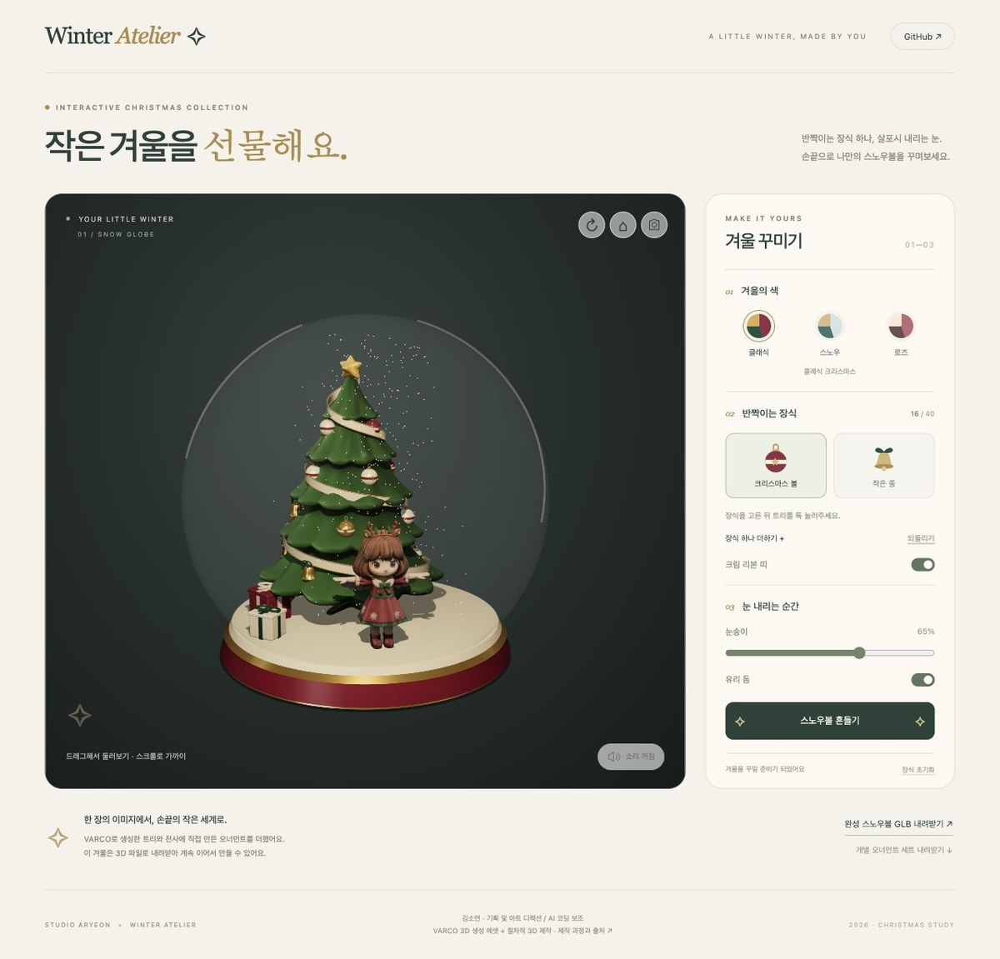

# Winter Atelier · 작은 겨울을 선물해요

VARCO로 만든 트리와 아기 천사에 직접 구성한 3D 오너먼트를 더한 인터랙티브 스노우볼입니다. 생성형 AI 에셋을 선별·수정하고 웹에서 조작할 수 있는 장면으로 연결하는 제작 과정을 담았습니다.

**[스노우볼 체험하기](https://studio-penumbra.com/winter-atelier-snowglobe/)** · **[소품 GLB 모음](docs/assets/ornaments.zip)** · **[완성 장면 GLB](docs/assets/snowglobe.glb)**



## 체험

- 드래그로 회전하고 스크롤·핀치로 확대합니다.
- 방울 또는 종을 고른 뒤 트리를 클릭해 장식을 답니다. ‘장식 하나 더하기’ 버튼도 사용할 수 있습니다. 최대 40개.
- 클래식 / 스노우 / 로즈 팔레트로 소품과 받침대의 색을 바꿉니다. 트리·천사의 원본 텍스처는 유지합니다.
- 리본과 유리 돔을 켜고 끄고, 눈의 양을 조절하거나 스노우볼을 흔듭니다.
- PNG 이미지 또는 현재 꾸민 장면의 GLB를 저장합니다. 소리는 기본 꺼짐입니다.

## 제작 과정

1. 이미지 방향 설정: 큰 머리의 작은 천사, 버건디 의상, 크림색 날개, 단순하고 귀여운 트리.
2. VARCO 이미지→3D 생성 결과 검토: 구멍이 많던 트리를 겹치는 솔리드 단 형태로 재생성.
3. 웹용 에셋 정리: 트리 약 5만 / 천사 약 8만 삼각형. 텍스처 축소·압축 후 두 GLB 합계 약 8.4 MB.
4. Three.js 지오메트리로 방울·종·리본·선물상자·받침대·유리 돔 제작. 개별 GLB 15종 출력.
5. 어두운 전시 배경과 따뜻한 단일 스포트라이트, 유리 재질, 눈 파티클, 장식 배치와 색 변경 인터랙션 구현.
6. 데스크톱·모바일 레이아웃과 다운로드 확인 후 GitHub Pages 공개.

기획·아트 디렉션: **Studio Aryeon / 김소연**. 코드·절차적 소품 제작에 AI 보조를 사용했습니다. 생성형 모델이 만든 부분과 코드로 제작한 부분은 [출처 문서](ASSET_CREDITS.md)에 구분했습니다.

## 현재 범위

천사는 리깅되지 않은 고정 포즈입니다. 보행 애니메이션은 없습니다. 유리와 눈은 웹 렌더링용 표현이며 물리 유체 시뮬레이션이 아닙니다. GLB에는 정적 메시·재질·배치가 담기며 웹 인터랙션, 조명, 눈 파티클은 포함되지 않습니다. 효과음은 Web Audio 합성이며 VARCO Sound 생성물이 아닙니다.

## 로컬 실행

Node.js 20 이상과 Python 3 환경에서:

```sh
npm ci
npm run build
npm run serve
```

`http://localhost:8766`에서 엽니다. `file://`로 HTML을 직접 열면 GLB를 불러올 수 없습니다. 실행에 API 키·유료 API·로그인은 필요하지 않습니다. 빌드 산출물과 에셋을 모두 같은 저장소에서 제공합니다.

```sh
npm run assets  # 소품 GLB 재생성
npm run build  # 웹 번들 재생성
```

`src/props.js`: 소품 생성 · `src/app.js`: 장면·인터랙션 · `docs/`: GitHub Pages 배포 파일.

## Blender / Unity 가져오기

- **Blender:** File → Import → glTF 2.0으로 `docs/assets/snowglobe.glb` 또는 `docs/assets/props/*.glb`를 불러옵니다. `scripts/import_blender.py`는 장면을 새 컬렉션에 넣는 선택적 도우미입니다. 이 환경의 Blender는 시작 시 Metal 초기화 오류로 종료되어, Blender 안의 재질·저장은 검증하지 못했습니다.
- **Unity:** glTF를 지원하는 importer를 프로젝트에 설치한 뒤 GLB를 가져옵니다. 재질은 사용하는 렌더 파이프라인에 맞게 조정해야 합니다. Unity 프로젝트·프리팹 검증은 이 저장소의 범위에 포함되지 않습니다.

웹에서는 실제 GLB 로딩과 장면 내보내기를 검증했습니다. 돔의 투명도·굴절은 다른 뷰어/엔진에서 다르게 보일 수 있습니다.
